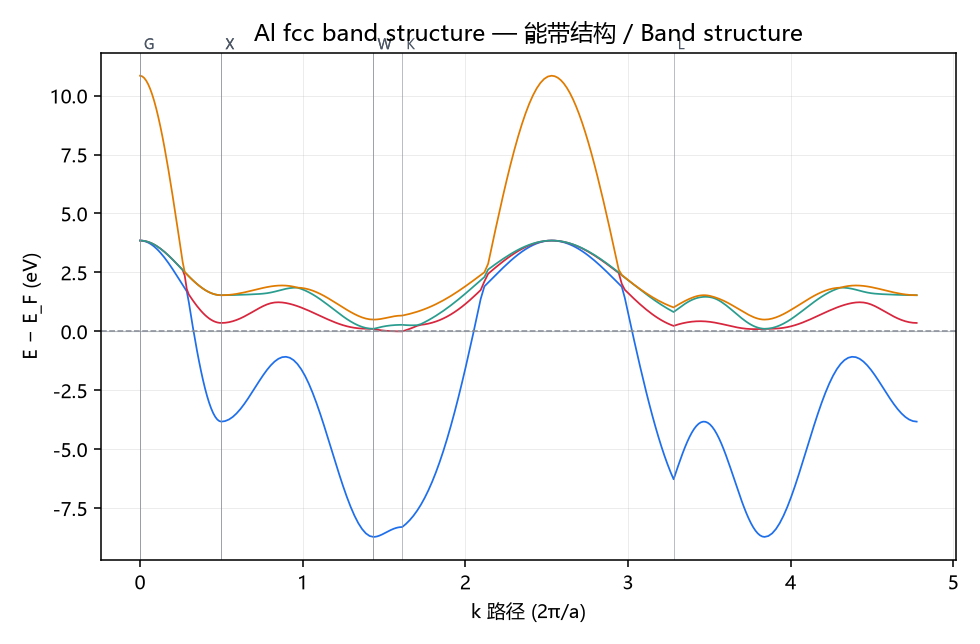
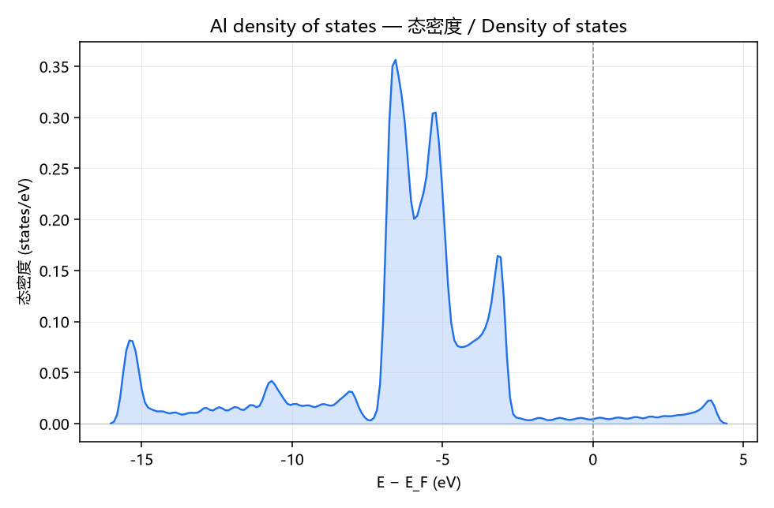
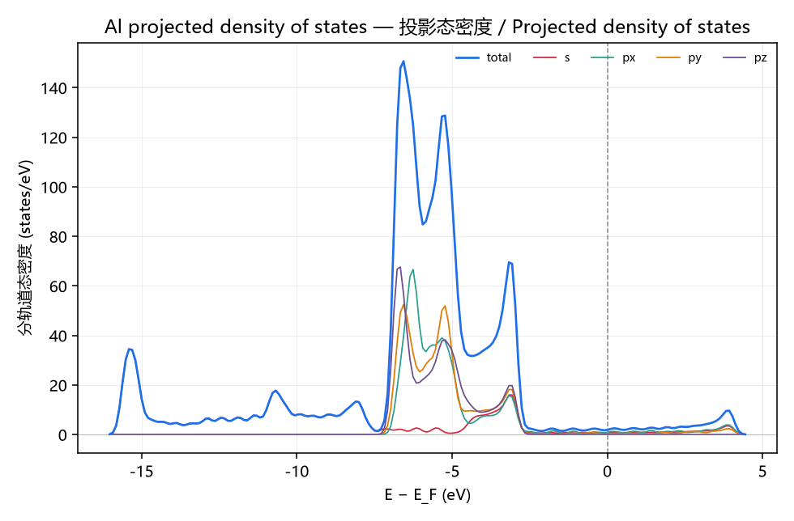
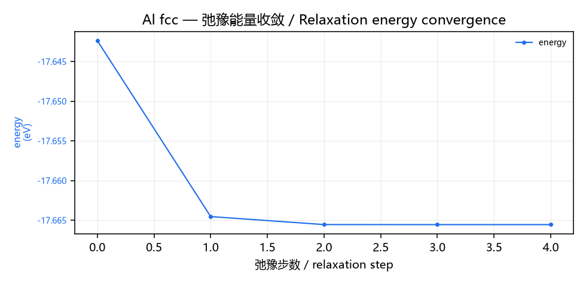
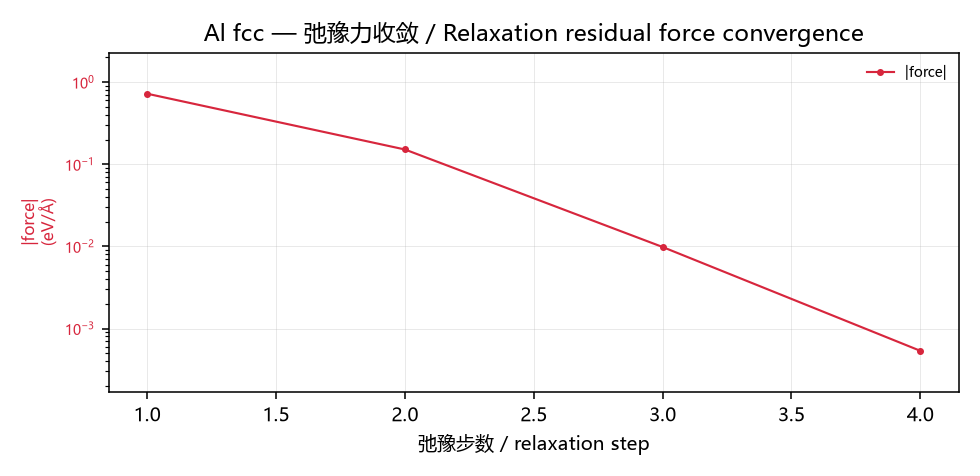
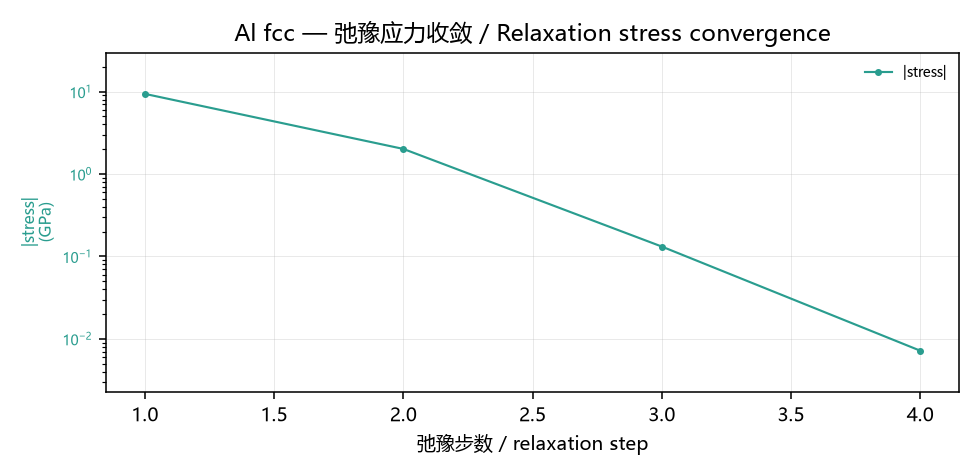

# 案例：铝面心立方晶胞的弛豫、能带与态密度

> 工作流文件：[`workflows/11_solid_state_dft.json`](../../workflows/11_solid_state_dft.json)
> 14 个节点 · 16 条边 · 本机实跑 `completed` / 0 错误
> 本文所有数字均为本仓库代码的实际输出，不是示意值。

---

## 1. 案例要回答的问题

给一块铝，你想知道三件事：

1. 它最舒服的晶格常数是多少（**弛豫**）
2. 电子能怎么分布（**能带**）
3. 费米面附近有没有态（**态密度**），是金属还是绝缘体

这三件事在真实 DFT 里是三次独立计算。本案例把它们串成一张图，并且刻意让
后两次跑在**第一次弛豫出来的那个晶胞**上——这是本案例真正要演示的一步（见 §5）。

---

## 2. 输入：铝（面心立方）

| 参数              | 值                              |
| ----------------- | ------------------------------- |
| 元素              | Al（铝）                        |
| 晶格类型          | fcc（面心立方）                 |
| 初始晶格常数 `a`  | `4.05 Å`（室温实测值）          |
| 原胞原子数        | 1                               |

Al 的原胞就是 1 个原子、4 个轨道（1 个 s + 3 个 p）。**这一点决定了后面所有
数字的上限**：Al 的 `d` 轨道数为 0，所以这个模型最多给出 4 条带。想要更多带必须
引入 d 轨道或改用超胞——这是**结构性上限，不是调参能解决的问题**。

---

## 3. 数据流（一张图看懂）

```
MaterialInputNode            铝（fcc），a = 4.05 Å
        │ material
        ▼
ABACUSNode  cell_relax       晶胞弛豫 → 返回**弛豫后的晶胞**
        │ material            ← 关键：a 已经是 3.987 Å
        ├──────────────┬──────────────┐
        ▼              ▼              ▼
ABACUSNode bands   ABACUSNode dos   ABACUSNode pdos
        │spectrum       │spectrum       │spectrum
        ▼               ▼               ▼
FigureExport        FigureExport    FigureExport
能带图.png          态密度.png      PDOS.png

（弛豫节点的 spectrum 端口额外接三张收敛图：能量 / 力 / 应力）

bands.table ─┐
relax.material ─┼→ SummaryTableNode → ReportBuilderNode → ReportExportNode（HTML）
pdos.spectrum ─┤
bands.text ────┘
```

---

## 4. 六张产物图

### 4.1 能带结构 `Al_能带图.png`



- 路径：Γ → X → W → K → Γ → L → W → X
- 纵轴 `E − E_F`，费米面画在 `E − E_F = 0`（灰色虚线）
- **4 条带**，与「1 原子 × 4 轨道」的结构上限一致
- 带隙 `0.000 eV`，且费米面处有带穿过 → 金属，与铝的实验事实一致

### 4.2 总态密度 `Al_态密度_DOS.png`



费米面（虚线，x = 0）处态密度**非零**，这是判定金属的直接证据。

### 4.3 投影态密度 `Al_投影态密度_PDOS.png`



分 s / px / py / pz 四个通道。费米面附近的态密度**几乎全部来自 p 轨道**，
s 轨道贡献极小——与 Al 的 3s²3p¹ 价电子构型吻合。

### 4.4 弛豫能量收敛 `Al_弛豫能量收敛.png`



### 4.5 弛豫力收敛 `Al_弛豫力收敛.png`



### 4.6 弛豫应力收敛 `Al_弛豫应力收敛.png`



**为什么收敛要拆成三张图**：能量（eV）、残余力（eV/Å）、应力（GPa）三者量纲不同
且量级相差三到四个数量级。叠在一张图上只有最靠边的那条曲线看得见，纵轴对数刻度
则画不出负值——所以力与应力画的是**绝对值**，并在图例里标明 `|force|` / `|stress|`。

---

## 5. 实测结果

```
Agent 规划：intent=solid_state_dft，7 节点 / 10 边
validate: PASS   status: completed   errors: 0   692 ms

  relax  cell-relax Al fcc: a 4.050 → 3.987 Å（实验 4.05，误差 −1.6%）
  bands  Al fcc a=3.987 Å，Γ→X→W→K→Γ→L→W→X，gap 0.000 eV，E_F −6.851 eV
  pdos   Al fcc a=3.987 Å，DOS(E_F) = 0.2152 states/eV → 金属
```

| 量                       | 本模型           | 实验 / DFT 参考  | 偏差      |
| ------------------------ | ---------------- | ---------------- | --------- |
| 晶格常数 a               | 3.987 Å          | 4.05 Å           | **−1.6 %** |
| 带隙                     | 0.000 eV         | 0（金属）        | 一致      |
| 费米面处态密度           | 0.2152 states/eV | 非零             | 定性一致  |

### 为什么三处 a 必须一致

`bands` 与 `pdos` 报告的晶格常数必须等于 `relax` 输出的晶格常数（容差 0.01 Å），
这一点有测试断言。原因是一个真实发生过的缺陷：

> 弛豫节点 `_relax` 曾经**原样返回输入 material**，于是下游能带/PDOS 按**原始**
> 晶格常数重算。结果报告写「a 4.050 → 3.987 Å」，而能带图画的是 a = 4.050 Å——
> 每个数字都自洽地错在同一个晶胞上。

现在 `_relaxed_material()` 返回**拷贝**（不是同一个对象，避免污染共享上游产物的
其他分支），并且这三个 `a` 被测试逐个锁死。

---

## 6. 与真实 ABACUS 的关系，以及必须说清的局限

`ABACUSNode` 在本机**没有装 ABACUS**，因此实际执行走的是内置引擎
`internal:tight-binding`（Slater-Koster 两中心模型）。节点会照常生成
ABACUS 的 `INPUT` 与 `STRU` 输入卡——在装了 ABACUS 的机器上会走
`external:abacus` 分支。

**但即使装上 ABACUS，本案例的内置参数也还对不上**。这一点如实写在下面，
因为「能跑」和「能对」是两回事：

### 6.1 已知问题：能带色散方向标定

内置紧束缚的 Al 参数表目前给出 Γ 点最低带（−3.00 eV）**高于** X 点最低带
（−10.68 eV），**色散方向是颠倒的**。物理上 Al 是面心立方近自由电子金属，
Γ 点应当是自由电子分支的最低点。

直接翻转符号会得到 Γ 点 −25 eV 的非物理结果，所以这不是「符号写反了」，
而是 **onsite 能与 hopping 积分需要整体重新标定**。这是模型标定问题，
不是代码 bug。

### 6.2 已知限制：能带数是结构上限

如 §2 所述，Al 原胞 1 原子 × 4 轨道 = 最多 4 条带。要展示更多带必须引入
d 轨道或用超胞。

### 6.3 模型本身的适用范围

| 项目                         | 说明                                                    |
| ---------------------------- | ------------------------------------------------------- |
| 晶格常数误差                 | Al −1.6 %、Ni −0.9 %、Ag −1.2 %、Cu −1.4 %、Fe −0.1 %、W −2.1 %、Mg −0.7 % |
| 不处理                       | 自旋极化、强关联、范德华修正                            |
| 多元素化合物                 | 按过渡金属优先取一种元素计算                              |
| 定性趋势                     | 可信（金属性、带隙有无）                                |
| **绝对数值**                 | **以 DFT 为准，不要引用本模型的绝对值作为结论**         |

### 6.4 被修掉的几处「看起来对但其实错」

这些不是调参问题，是曾经真实存在的错误，记录在此以便复核：

1. **硬填 `E ≤ E_F` 的势能面不连续**——每条带跨费米面跳一次，实测 Al 曲线每
   ~0.1 Å 出现一个虚假局域极小，梯度优化器原地不动却报 converged。改用
   `_fermi_occupation` + `_fermi_level`（按电子数二分求费米面，展宽 0.15 eV）。
   **势能面有台阶时，谈收敛判据没有意义。**
2. **Brillouin 区网格必须半开 `[0,1)`**——闭合 `[0..1]` 把 Γ 算两遍
   （Γ 是 Al 能带最低点），积分被固定偏置。实测弛豫结果的 k 点无关性：
   闭合极差 0.26 Å vs 半开 0.037 Å。
3. **Born 排斥项曾用非对称归一化**，在 dev = 0.864 处算出 −0.246——
   「墙」其实是井，Al 落在 3.527 Å。改成完全平方 `κ·CN·(dev − 1/dev)²`，
   数学上不可能为负，一次性消除整类错误。

---

## 7. 自己跑一遍

```bash
# 先触发节点发现
python -c "from nodes.loader import get_registry; get_registry()"

python scripts/run_demo_workflows.py          # 全部 11 个 Demo
# 或只跑这一个
python -c "
import json
from nodes.loader import get_registry
from workflow_engine import WorkflowEngine
get_registry()
wf = json.load(open('workflows/11_solid_state_dft.json', encoding='utf-8'))
res = WorkflowEngine(registry=get_registry(), workdir='output').run(wf)
print(res.status, res.errors)
"
```

产物落在各节点自己的 `write_files` 目标目录下（不是引擎 workdir），
六张 PNG 与一份 HTML 报告。

---

## 8. 一句话总结

内置紧束缚在**晶格常数**上给到 −1.6 %，在**金属性判定**上完全正确；
但 Al 的**能带色散方向**尚未标定好。把它当作「能跑通全流程、能交付全部产物
图、能自洽校验一致性」的示范是成立的，把它当作可发表的电子结构计算结果则不成立。